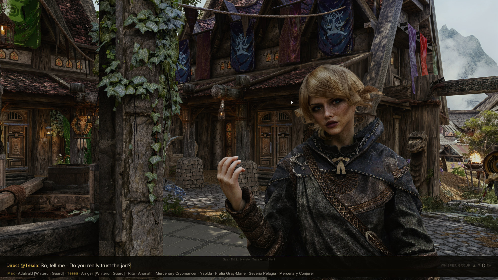

  

<h1 align="center">SkyrimNet</h1>

  <b>Every NPC in Skyrim, brought to life with AI.</b> 
  They talk, remember, react and act, voiced in real time. 
  Made by <a href="https://fateless.ai">Fateless</a>.

  
  
  
  

  <b>As featured on</b> the <a href="https://developer.nvidia.com/blog/nvidia-rtx-spark-powers-neural-rendering-and-ai-characters-in-games/">NVIDIA Technical Blog</a> and the <a href="https://blogs.nvidia.com/blog/local-ai-rtx-spark-laptops-software-updates/">NVIDIA Blog</a>

---

## What is SkyrimNet?

SkyrimNet turns every character in Skyrim into someone you can actually talk to. Speak into your microphone or type, and the NPC in front of you answers in their own voice, with their own personality, about what is happening right now.

NPCs **remember**. Each one keeps their own memories of what you did and said, and of what they saw happen around them, and brings them up later. They **notice**: they react to what they could plausibly see and hear, talk among themselves, and keep a scene going while you watch. And they **act**: an NPC can follow you, hand over gold, craft you a shield, draw a weapon or walk away, as the situation calls for.

It all runs as a single Skyrim mod. No separate app, no server window to keep open. Install it, launch the game, and you are talking to NPCs within minutes.

## See it in action

| | |
|:---:|:---:|
|  **Lydia gives you her gear** |  **Meet Nazeem** |
|  **Balgruuf's court debates the dragon threat** |  **Arvel talks his way free** |

More on the [SkyrimNet YouTube channel](https://www.youtube.com/@SkyrimNet).

## Highlights

- **Real conversations.** Context-aware dialogue with any NPC, streamed so the voice starts while the reply is still being written. Hand-written bios for Skyrim's named characters, with more for popular mods in the Content Library.
- **Memory.** Every NPC has a private memory, recalled by meaning, that fades with time unless it mattered. NPCs can keep diaries too.
- **Voices.** Local and cloud text-to-speech engines, with voice cloning, plus voice effects for werewolves, draugr, ghosts and more.
- **Speak or type.** Speech recognition runs on your own PC, and an in-game chat overlay supports whispering, group talk and addressing NPCs by name.
- **Actions.** NPCs choose what to do as well as what to say, from a library that other mods can extend.
- **Vanilla dialogue too.** Your dialogue-menu picks are spoken in your voice, and NPCs can use their original quest lines when it fits.
- **Vision.** NPCs can see and comment on what you wear, carry and do.
- **Bard songs.** Bards compose and perform new songs about your adventures.
- **Built for modders.** Papyrus and C++ APIs, YAML triggers and actions, and editable prompt templates fed with live game data.

Full tour: **[docs/FEATURES.md](docs/FEATURES.md)**.

## Get started

SkyrimNet needs a language model: the AI that writes what NPCs say. Choose how you want to run it.

### ✨ Fateless: the easiest way

One account for everything SkyrimNet needs: dialogue, voices, speech recognition and bard songs. No API keys, no other accounts, nothing to configure. Models are tuned for each job, so NPCs reply fast and stay in character.

Plans start at $10 a month. Update to SkyrimNet Beta29 or later, choose Fateless in the settings, and sign in.

**[Get started with Fateless →](https://fateless.ai/inference?from=sn-github-readme)**

### ☁️ Your own cloud account

Use an [OpenRouter](https://openrouter.ai) key, or any OpenAI-compatible service. The setup wizard offers ready-made model presets: Budget, Balanced and Performance.

### 🖥️ Run it locally on your RTX GPU

Free and private: the model runs on your own PC through LM Studio, Ollama, KoboldCpp or llama.cpp. Small local models such as **NVIDIA Nemotron 3.5 Bolt** are a great way to try SkyrimNet. For the richest conversations, we recommend Fateless or a cloud model.

- **Setup help:** see the `#local-llm-discussion` channel on our [Discord](https://discord.gg/4Ft5shCXXk).
- **NVIDIA RTX Spark (Windows on Arm):** install with the [Arm build of Mod Organizer](https://github.com/ndabas/modorganizer/releases#release-v2.5.2-woa.1).

You can mix these. For example, use Fateless for dialogue and a local engine for voices.

### Install

1. **Download** the latest release from [GitHub Releases](https://github.com/MinLL/SkyrimNet-GamePlugin/releases).
2. **Install** it with your mod manager (Mod Organizer 2, Vortex, ...), along with the [requirements](#requirements).
3. **Enable** `SkyrimNet.esp` in your load order.
4. **Launch** the game through SKSE and open [localhost:8080](http://localhost:8080) in your browser.
5. **Follow** the setup wizard. It picks working defaults for your PC and gets you talking.

Using Piper, the default voice engine that runs on the CPU? Download the [Piper voice models](https://drive.google.com/file/d/1zmBJCLlaGWKBW8Z87rw2MiaNE-8cdSlv/view) and install them as a separate mod.

Stuck? Ask on [Discord](https://discord.gg/gHHS7HpJS9).

## Requirements

- Skyrim Special Edition / Anniversary Edition, or Skyrim VR
- A CPU with AVX2 (almost any PC CPU from the last 10 years)
- [Skyrim Script Extender (SKSE)](https://skse.silverlock.org/)
- [Address Library for SKSE Plugins](https://www.nexusmods.com/skyrimspecialedition/mods/32444)
- [powerofthree's Papyrus Extender](https://www.nexusmods.com/skyrimspecialedition/mods/22854)
- [PapyrusUtil SE](https://www.nexusmods.com/skyrimspecialedition/mods/13048)
- [powerofthree's Tweaks](https://www.nexusmods.com/skyrimspecialedition/mods/51073) ([VR version](https://www.nexusmods.com/skyrimspecialedition/mods/59510)), with its `Load EditorIDs` fix left on (the default)
- [Prisma UI](https://www.nexusmods.com/skyrimspecialedition/mods/148718) and its requirement [Media Keys Fix SKSE](https://www.nexusmods.com/skyrimspecialedition/mods/92948), or Magelight UI, for the in-game chat and dashboard
- The latest [Microsoft Visual C++ Redistributable](https://learn.microsoft.com/en-us/cpp/windows/latest-supported-vc-redist?view=msvc-170)

<b>Optional extras, and Skyrim SE / VR specifics</b>

**Optional**
- [UIExtensions](https://www.nexusmods.com/skyrimspecialedition/mods/17561), for the input wheel.
- [CUDA Toolkit 12.x](https://developer.nvidia.com/cuda-12-9-1-download-archive) (**not** 13.x), to speed up speech recognition on NVIDIA GPUs. Restart your PC after installing it. The Speech-to-Text test on the Test & Easy Setup page shows whether CUDA is in use.

**Skyrim SE without ESL support**
- [Backported Extended ESL Support (BEES)](https://www.nexusmods.com/skyrimspecialedition/mods/106441)

**Skyrim VR**
- [Skyrim VR ESL Support](https://www.nexusmods.com/skyrimspecialedition/mods/106712), instead of BEES
- [Skyrim VR Refocused](https://www.nexusmods.com/skyrimspecialedition/mods/32737), or a similar mod that keeps Skyrim focused
- [MFG Fix NG](https://www.nexusmods.com/skyrimspecialedition/mods/133568)

## Built on SkyrimNet

SkyrimNet's modder API has a growing ecosystem. Two major mods built on it:

- **[SeverActions](https://github.com/Severause/SeverActions)**: an AI-first follower framework, with rapport, trust and mood per companion, companion banter, and 70+ actions from crafting to a full crime-and-arrest system.
- **[IntelEngine](https://github.com/galanx/IntelEngine-GamePlugin)**: NPCs that travel the world on your command and on their own and keep appointments, with an AI Dungeon Master that creates quests, ambushes and faction wars on the fly.

## For modders and developers

- **Modding guides:** [docs/modding](docs/modding) covers actions, triggers, prompts and mod integration.
- **APIs:** the Papyrus API (`SkyrimNetApi`), the C++ API in [CppAPI](CppAPI), and an MCP server for AI tools. See [docs/FEATURES.md](docs/FEATURES.md#modder-api).
- **Contributing:** [CONTRIBUTING.md](CONTRIBUTING.md), including how to build this repository.

## Community

- **Discord:** [discord.gg/gHHS7HpJS9](https://discord.gg/gHHS7HpJS9), for help, news and your stories
- **YouTube:** [@SkyrimNet](https://www.youtube.com/@SkyrimNet)
- **Fateless:** [fateless.ai](https://fateless.ai) · [Fateless Inference](https://fateless.ai/inference)

**Support the project:**

  
  

## Credits

- The community of developers who build SkyrimNet: code, design, testing and ideas.
- ArtFromTheMachine, for the Piper voice models.
- The SkyrimNet community, for the hand-written character bios.

SkyrimNet is made by [Fateless](https://fateless.ai). It is not open source; see [LICENSE](LICENSE).
